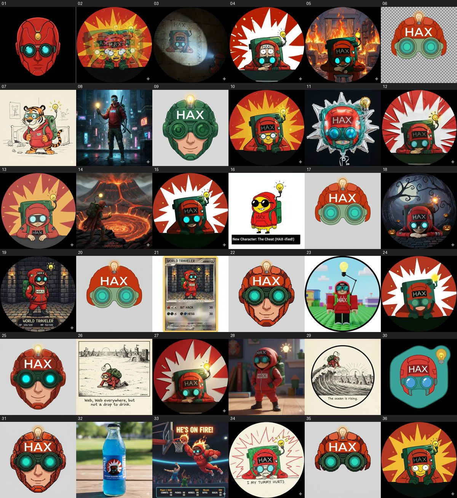

# art

Artwork for **[HAX](https://haxtheweb.org)**: open-source tools that let anyone create, remix and publish on the web without needing to understand the web.

## Meet the Future Traveler

HAX's official mascot: a red-helmeted, steampunk-goggled time traveler who traveled to the future to bring our ideas to life. He collects the best ideas of every era and carries them into the future, where data flows like water. **Dream it, remix it, have it, share it.** Read his story and character sheet in [`future-traveler/`](future-traveler/README.md).

## What's in this repo

| Path | Contents |
|---|---|
| [`hax-art/`](hax-art/) | **HAX art**, a portfolio HAXsite for browsing everything here, built with the HAX CLI. Live at [haxtheweb.github.io/art](https://haxtheweb.github.io/art/) once GitHub Pages is on |
| [`future-traveler/`](future-traveler/) | 36 variants of the mascot, plus a contact sheet |
| [`haxtheweb/`](haxtheweb/) | Logos, stickers, banners, thumbnails, GIFs, layered source files |
| [`haxtheweb/wanted-poster/`](haxtheweb/wanted-poster/) | WANTED: HAX, the Open Web Outlaw: an old-west poster starring the `rpg-character` in a cowboy hat, with alt text and a social caption |
| [`haxtheweb/hax-the-web-game/`](haxtheweb/hax-the-web-game/) | HAX the Web: a 16-bit attract-mode title screen and speed run where an `rpg-character` collects 12 pieces of HAX lore, then gets a run report. Playable page, stills and social posts |
| [`haxtheweb/hax-of-the-web/`](haxtheweb/hax-of-the-web/) | HAX of the Web: a Halloween arcade title screen homage starring the `rpg-character` zombie pirate girl, with Merlin cheat codes, an idle demo of real HAXcms editing, and PRESS START into a playable HAXcms site. Live at [hax-of-the-web.surge.sh](https://hax-of-the-web.surge.sh/) |
| [`haxtheweb/rpg-glitch/`](haxtheweb/rpg-glitch/) | RPG Glitch: the `rpg-character` glitching between versions of itself on an 80s CRT. Click for a new character; every character gets a shareable link that also opens in [rpg-me](https://github.com/haxtheweb/rpg-me) |
| [`haxtheweb/hax-morph/`](haxtheweb/hax-morph/) | HAX Morph: HAX glitches into Headless Authoring Experience, back to HAX, then into Human, Agent, Experience, with `rpg-character`s thrown into the decaying bits. Looping GIF, still, and the tools that render it |
| [`presentation-materials/episode-xxvi/`](presentation-materials/episode-xxvi/) | HAX Episode XXVI: Return of the Open Web: a space-opera opening crawl with an original synth fanfare, catching people up on HAX in 2026 |
| [`presentation-materials/hax-the-web-intro/`](presentation-materials/hax-the-web-intro/) | HAX The Web opening titles: a 30-second neon title sequence |
| [`presentation-materials/`](presentation-materials/) | Diagrams for talks, and [HAX in under a minute](presentation-materials/hax-in-a-minute/): a doodle explainer as MP4, GIF, PPTX and stills |
| [`HAXLogo.svg`](HAXLogo.svg) | Primary logo |
| [`manifest.json`](manifest.json) | Machine-readable catalog with alt text and tags |
| [`AGENTS.md`](AGENTS.md) / [`llms.txt`](llms.txt) | Guides for LLMs and coding agents |
| [`LICENSING.md`](LICENSING.md) | Reuse terms |

## Using the art

Attribution: **HAX (haxtheweb), https://github.com/haxtheweb/art**. Please read [`LICENSING.md`](LICENSING.md): some variants are parodies of other people's work and need extra care.

Hotlinking? Use raw URLs like `https://raw.githubusercontent.com/haxtheweb/art/main/future-traveler/funny-traveler-15.png`. File names are kept stable; renames are rare and announced in the commit history.

## Contributing

Open a pull request. Add new variants as the next numbered file and add a [`manifest.json`](manifest.json) entry. See [`AGENTS.md`](AGENTS.md) for the rules. The project's [contributing guide, code of conduct and CLA](https://github.com/haxtheweb) apply.
