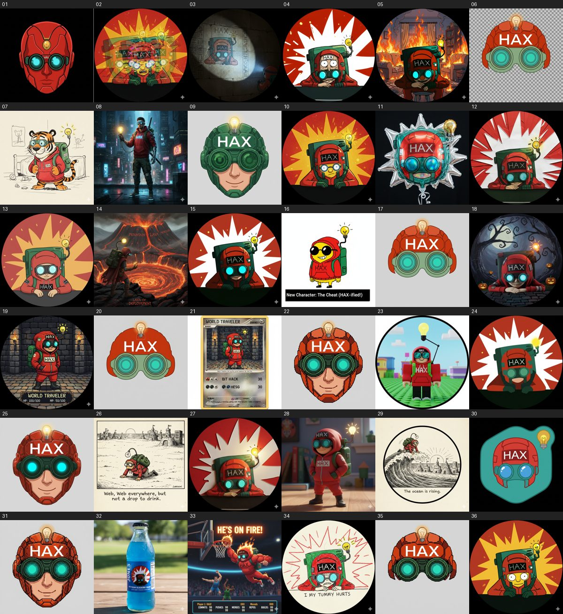

# art

Artwork for **[HAX](https://haxtheweb.org)**: open-source tools that let anyone create, remix and publish on the web without needing to understand the web.

## Meet the World Traveler

A red-helmeted, steampunk-goggled time traveler who collects the best ideas of every era and carries them into the future, where data flows like water. **Dream it, remix it, have it, share it.** Read his story and character sheet in [`world-traveler/`](world-traveler/README.md).

## What's in this repo

| Path | Contents |
|---|---|
| [`world-traveler/`](world-traveler/) | 36 variants of the mascot, plus a contact sheet |
| [`haxtheweb/`](haxtheweb/) | Logos, stickers, banners, thumbnails, GIFs, layered source files |
| [`haxtheweb/wanted-poster/`](haxtheweb/wanted-poster/) | WANTED: HAX, the Open Web Outlaw: an old-west poster starring the `rpg-character` in a cowboy hat, with alt text and a social caption |
| [`haxtheweb/hax-the-web-game/`](haxtheweb/hax-the-web-game/) | HAX the Web: a 16-bit attract-mode title screen and speed run where an `rpg-character` collects 12 pieces of HAX lore, then gets a run report. Playable page, stills and social posts |
| [`presentation-materials/episode-xxvi/`](presentation-materials/episode-xxvi/) | HAX Episode XXVI: Return of the Open Web: a space-opera opening crawl with an original synth fanfare, catching people up on HAX in 2026 |
| [`presentation-materials/hax-the-web-intro/`](presentation-materials/hax-the-web-intro/) | HAX The Web opening titles: a 30-second neon title sequence |
| [`presentation-materials/`](presentation-materials/) | Diagrams for talks, and [HAX in under a minute](presentation-materials/hax-in-a-minute/): a doodle explainer as MP4, GIF, PPTX and stills |
| [`HAXLogo.svg`](HAXLogo.svg) | Primary logo |
| [`manifest.json`](manifest.json) | Machine-readable catalog with alt text and tags |
| [`AGENTS.md`](AGENTS.md) / [`llms.txt`](llms.txt) | Guides for LLMs and coding agents |
| [`LICENSING.md`](LICENSING.md) | Reuse terms |

## Using the art

Attribution: **HAX (haxtheweb), https://github.com/haxtheweb/art**. Please read [`LICENSING.md`](LICENSING.md): some variants are parodies of other people's work and need extra care.

Hotlinking? Use raw URLs like `https://raw.githubusercontent.com/haxtheweb/art/main/world-traveler/funny-traveler-15.png`. File names are stable and will not be renamed.

## Contributing

Open a pull request. Add new variants as the next numbered file and add a [`manifest.json`](manifest.json) entry. See [`AGENTS.md`](AGENTS.md) for the rules. The project's [contributing guide, code of conduct and CLA](https://github.com/haxtheweb) apply.
