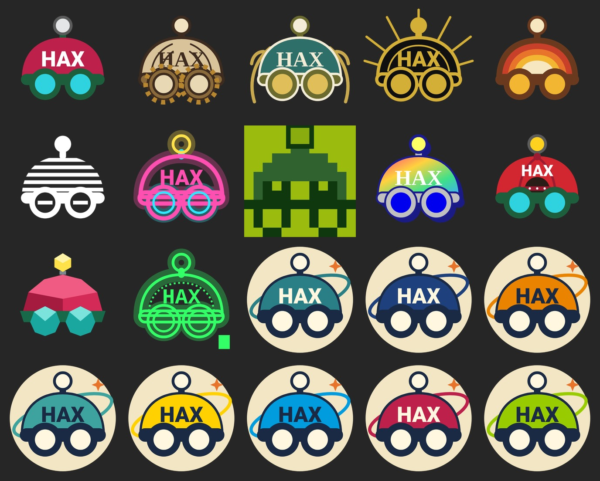

# The Future Traveler across time

**Status: in use.** These are the eras the Future Traveler remixes through at the right end of the HAX network bar: hover him and he tears through every one, click and he stays in the next.

He has collected the best ideas of every era in his backpack, so the same icon can be drawn the way each era would have drawn it. He is still him in all of them: the helmet with HAX on it, the goggles, the lightbulb. His story is in [`future-traveler/README.md`](../future-traveler/README.md) and in PRAW's [`FUTURE-TRAVELER.md`](https://github.com/haxtheweb/praw/blob/main/FUTURE-TRAVELER.md).

Each era follows one of the styles the [poster campaign](../haxtheweb/posters/) tells the story of the seven pillars in. The world of tomorrow comes once per pillar, in that pillar's color, like its posters.

| | Era | File | Drawn after |
|---|---|---|---|
|  | Today | [`future-traveler-now.svg`](svg/future-traveler-now.svg) | the icon as it ships |
|  | 1880s steam age | [`future-traveler-steam.svg`](svg/future-traveler-steam.svg) | [poster](../haxtheweb/posters/social/hax_1880s_poster.png) |
|  | 1900s modern marvel | [`future-traveler-nouveau.svg`](svg/future-traveler-nouveau.svg) | [poster](../haxtheweb/posters/social/hax_1900s_poster.png) |
|  | 1920s roaring twenties | [`future-traveler-deco.svg`](svg/future-traveler-deco.svg) | [poster](../haxtheweb/posters/social/hax_1920s_poster.png) |
|  | 1970s rainbow | [`future-traveler-rainbow.svg`](svg/future-traveler-rainbow.svg) | [poster](../haxtheweb/posters/social/hax_1970s_poster.png) |
|  | 1980s corporate | [`future-traveler-stripes.svg`](svg/future-traveler-stripes.svg) | [poster](../haxtheweb/posters/social/hax_1980s_poster.png) |
|  | 1980s cyberpunk | [`future-traveler-neon.svg`](svg/future-traveler-neon.svg) | [poster](../haxtheweb/posters/social/hax_1980s_cyberpunk_poster.png) |
|  | Handheld, four greens | [`future-traveler-handheld.svg`](svg/future-traveler-handheld.svg) | [poster](../haxtheweb/posters/social/hax_gameboy_poster.png) |
|  | 1990s early web | [`future-traveler-web.svg`](svg/future-traveler-web.svg) | [poster](../haxtheweb/posters/social/hax_1990s_poster.png) |
|  | 1990s snapback | [`future-traveler-snapback.svg`](svg/future-traveler-snapback.svg) | the helmet worn as a red ball cap, no poster yet |
|  | 32-bit polygons | [`future-traveler-polygon.svg`](svg/future-traveler-polygon.svg) | [poster](../haxtheweb/posters/social/hax_ps_poster.png) |
|  | Terminal | [`future-traveler-terminal.svg`](svg/future-traveler-terminal.svg) | [poster](../haxtheweb/posters/social/hax_hacker_poster.png) |
|  | 1960s world of tomorrow: Ubiquity | [`future-traveler-tomorrow-ubiquity.svg`](svg/future-traveler-tomorrow-ubiquity.svg) | [poster](../haxtheweb/posters/social/hax_tomorrow_all_poster.png) |
|  | 1960s world of tomorrow: Accessible | [`future-traveler-tomorrow-accessible.svg`](svg/future-traveler-tomorrow-accessible.svg) | [poster](../haxtheweb/posters/social/hax_tomorrow_accessible_poster.png) |
|  | 1960s world of tomorrow: Efficient | [`future-traveler-tomorrow-efficient.svg`](svg/future-traveler-tomorrow-efficient.svg) | [poster](../haxtheweb/posters/social/hax_tomorrow_efficient_poster.png) |
|  | 1960s world of tomorrow: Extensible | [`future-traveler-tomorrow-extensible.svg`](svg/future-traveler-tomorrow-extensible.svg) | [poster](../haxtheweb/posters/social/hax_tomorrow_extensible_poster.png) |
|  | 1960s world of tomorrow: Free and open | [`future-traveler-tomorrow-open.svg`](svg/future-traveler-tomorrow-open.svg) | [poster](../haxtheweb/posters/social/hax_tomorrow_open_poster.png) |
|  | 1960s world of tomorrow: Platform agnostic | [`future-traveler-tomorrow-agnostic.svg`](svg/future-traveler-tomorrow-agnostic.svg) | [poster](../haxtheweb/posters/social/hax_tomorrow_agnostic_poster.png) |
|  | 1960s world of tomorrow: Remixable | [`future-traveler-tomorrow-remixable.svg`](svg/future-traveler-tomorrow-remixable.svg) | [poster](../haxtheweb/posters/social/hax_tomorrow_remixable_poster.png) |
|  | 1960s world of tomorrow: Sustainable | [`future-traveler-tomorrow-sustainable.svg`](svg/future-traveler-tomorrow-sustainable.svg) | [poster](../haxtheweb/posters/social/hax_tomorrow_sustainable_poster.png) |

## Files

- `svg/`: 24 by 24 grid vector, each with a `<title>`. No scripts, no outside references.
- `png/`: 512 by 512 renders with a transparent background (the handheld era and the world of tomorrow carry their own).
- [`eras.json`](eras.json): the catalog with alt text, the poster each follows and third-party flags. The same entries are in [`manifest.json`](../manifest.json) under `other_groups`.
- `contact-sheet.jpg`: all 20 in catalog order on the network bar's dark gray.

## Where they come from

The source is code, not these files: [`elements/hax-network-bar/lib/hax-future-traveler.js`](https://github.com/haxtheweb/webcomponents/blob/master/elements/hax-network-bar/lib/hax-future-traveler.js) in haxtheweb/webcomponents draws every era, and the files here are exported from it. To change an era or add one, change that file and export again; do not hand-edit the SVGs. In the bar each era also has its own small motion on hover (gears turn, the sunburst fans, the handheld's eyes blink, the cursor flashes), which a static file does not show.

They were drawn in SVG by Claude, an AI, under HAX team direction.

## Reuse

Three eras follow posters that are marked as homages in [`posters.json`](../haxtheweb/posters/posters.json): 1980s corporate, handheld and 32-bit, and the world of tomorrow follows a 1960s travel poster style. The icons name no product and copy no artwork, but review them before official promotion, as with the posters. See [`LICENSING.md`](../LICENSING.md).
