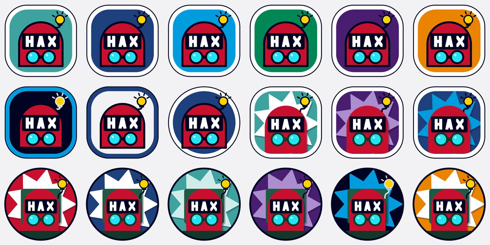

# Future Traveler icon concepts

**Status: concepts, not in use.** Icon explorations for HAX's official mascot, the Future Traveler, kept here because they're fun. For anything on-brand today, use [`funny-traveler-15.png`](../world-traveler/funny-traveler-15.png) (see [AGENTS.md](../AGENTS.md)).



Open [`index.html`](index.html) to try them: hover or tab to an icon and his lightbulb glows once, its rays spring out, then it stays lit. With reduced motion on, it just lights up with no movement.

## The three families

| Family | What it is | Files |
|---|---|---|
| Sticker | Die-cut sticker; the white (or colored) border keeps it readable on any surface. | `sticker-*` (9, incl. one round) |
| Paper sticker | The sticker frame with paper-cut layers and soft shadows inside. | `paper-sticker-*` (3) |
| Paper cut | Layered cut paper after [`funny-traveler-12.png`](../world-traveler/funny-traveler-12.png). | `paper-cut-*` (6) |

Each file name ends with the [DDD](https://github.com/haxtheweb/webcomponents/tree/master/elements/d-d-d) color token it sits on. The mascot keeps his own colors: red helmet, black HAX visor, cyan goggles, green pack, keystoneYellow bulb. On potentialMidnight the bulb's outline switches to limestoneLight, since dark ink disappears there.

## Files

- `svg/`: the source art, 512 × 512 vector. Each has a `<title>`; ids are prefixed by file name, so several can be inlined on one page.
- `png/`: 512 × 512 renders of the SVGs.
- `contact-sheet.jpg`: all 18 in catalog order.
- `index.html`: the glow demo.
- Alt text for every icon is in [`manifest.json`](../manifest.json) under `other_groups` → `future-traveler-icons/`.

## The bulb glow

In each SVG the bulb, stalk and rays are grouped as `<g class="ft-bulb">`, so an inline SVG can style that layer directly. The demo uses `` plus a small overlay instead, so it works with the files as they are. The motion plays once on `:hover` and `:focus-visible` (glow fades in, rays scale out with a little overshoot, settles lit) and is replaced by a static lit state under `prefers-reduced-motion: reduce`.

## Rebuilding

The SVGs and `index.html` are generated; edit [`tools/future-traveler-icons.py`](../tools/future-traveler-icons.py), not the files. From the repo root:

```sh
python3 tools/future-traveler-icons.py
```

PNGs and the contact sheet were rendered from the SVGs with librsvg and ImageMagick:

```sh
for f in future-traveler-icons/svg/*.svg; do
  rsvg-convert -w 512 -h 512 "$f" -o "future-traveler-icons/png/$(basename "$f" .svg).png"
done
# contact sheet: the PNGs in manifest order, 6 across
montage <png files in manifest order> -tile 6x -geometry 200x200+10+10 \
  -background "#f2f2f4" -strip -quality 85 future-traveler-icons/contact-sheet.jpg
```

## Provenance

Made in code (hand-written SVG geometry) by Claude, an AI, under HAX team direction, as remixes of the human-made original character via variants 15 and 12. Not hand-drawn. Reuse terms follow [LICENSING.md](../LICENSING.md).
