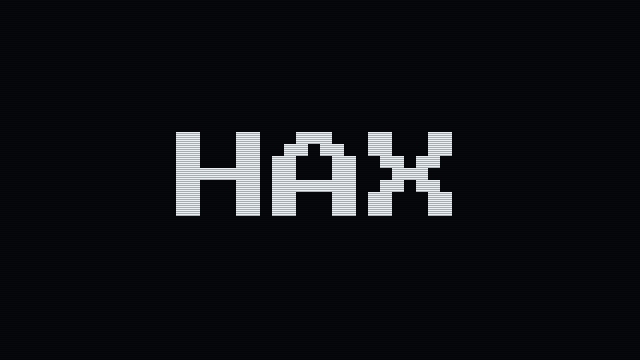

# HAX Morph

**HAX** decays into **Headless Authoring Experience**, back to **HAX**, then into **Human, Agent, Experience**, and loops. Each change breaks down in the deteriorating-digital-bits style of glitchy hacker-game loading screens: pixel-block decay, RGB channel splits, sliced scanline tears, bit-crushed color smears and drifting 0/1 noise. Real `rpg-character`s get thrown into the static at every transition. The H, A and X that carry through each phrase are lit in teal.



## Files

| File | Use it for |
|---|---|
| [`media/hax-morph.gif`](media/hax-morph.gif) | 640×360 loop, about 9 s. For READMEs, slides, chat and social. |
| [`media/hax-morph-still.png`](media/hax-morph-still.png) | 640×360 still of "Headless Authoring Experience". Preview image. |
| [`sprites/`](sprites/) | The 8 `rpg-character`s used in the glitches (`0.png`–`7.png`), rendered from the element on `webcomponents` main. Regenerate them with `tools/sprites.mjs`; don't hand-edit. |
| [`tools/`](tools/) | `sprites.mjs` renders the sprites from `webcomponents` main in headless Chromium; `render.py` builds the GIF and still. |

## Rebuild

From `tools/`:

```sh
npm install          # Press Start 2P font, Playwright, esbuild
npm run sprites      # optional: re-render sprites/ from webcomponents main (needs git)
npm run render       # writes media/hax-morph.gif and media/hax-morph-still.png
```

`render.py` needs Python 3 with Pillow and numpy. If Playwright's own browser isn't installed, set `CHROMIUM_PATH` to an existing Chromium (or run `npx playwright install chromium`).

The cast is `CAST` in `tools/sprites.mjs`: seeds `btopro`, `zpg` (pirate), `hax` (astronaut), `agent` (on fire), `human` (chef), `remix` (cowboy), `headless` (dino) and `experience` (bunny). The phrase order, colors and timing are at the top and bottom of `tools/render.py`. The random seed is fixed, so a rebuild with the same sprites gives the same GIF.

## How it moves

Each phrase holds for about 1–1.5 s with small random micro-glitches, so it never sits perfectly still. A transition takes about 0.9 s: corruption ramps up, the phrase swaps at the peak (with a little flicker between old and new), then the corruption ramps back down onto the new phrase. As it climbs, `rpg-character`s are dropped in and torn apart with everything else. At the peak, one sometimes punches through cleaner with an RGB split. Everything is drawn at 320×180 and scaled 2× with nearest-neighbor, under scan lines.

The type is [Press Start 2P](https://fonts.google.com/specimen/Press+Start+2P) (SIL Open Font License), from `@fontsource/press-start-2p`.

## Alt text

> Pixel text on a black screen reads HAX, then breaks apart into rainbow pixel blocks, scanline tears and streams of ones and zeros, with small pixel RPG characters flashing through the static. It rebuilds as "Headless Authoring Experience", decays back to HAX, then rebuilds as "Human, Agent, Experience", with the H, A and X of each phrase highlighted in teal.

## Suggested social caption

> HAX: Headless Authoring Experience. Also: Human, Agent, Experience. Same three letters, one platform for both.
>
> #HAXTheWeb #OpenSource #WebComponents #PixelArt

## Provenance

Made with an AI assistant (Claude) under HAX team direction. The text, glitch effects and scan lines are procedural Python (Pillow and numpy), not hand-drawn. The characters are the `rpg-character` element's own art, rendered by the element itself. The decaying-bits look is inspired by the general style of glitchy hacker-game loading screens; it uses no game assets and copies no specific artwork.
