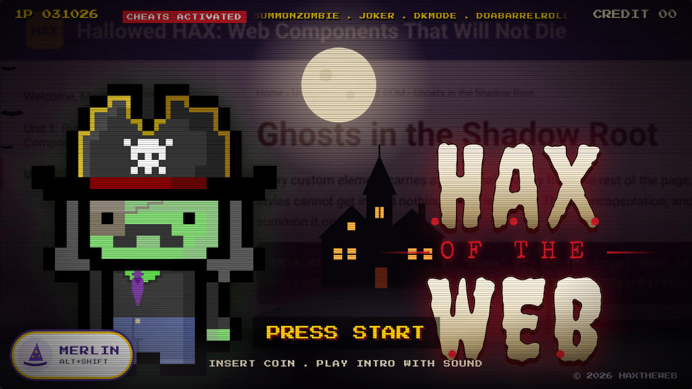

# HAX of the Web

A Halloween arcade easter egg for HAX. It's a homage to the title screen of a 1990s light-gun zombie game: a deep announcer intones "HAX… of the web," and the zombie pirate girl (the [`rpg-character`](https://github.com/haxtheweb/webcomponents/tree/main/elements/rpg-character) element's built-in `zpg` seed, in its pirate hat) rises in front of a haunted house. Behind them, a Halloween HAX course about web components slowly pans by. PRESS START drops you into a real HAXcms site to edit.

Live: **https://hax-of-the-web.surge.sh/**

## Files

| Path | Use it for |
|---|---|
| [`index.html`](index.html) | The title screen. It has no inline script, so it runs under a strict Content Security Policy. Built by `tools/build.mjs`; edit `tools/template.html`, not this file. |
| [`app.js`](app.js) | The title screen's own code: intro, Merlin, cheat codes, idle fire and demo, playground launcher. Built from `tools/template.html`. |
| [`hax-elements.js`](hax-elements.js) | `rpg-character` and `future-terminal-text-lite` (the HAX glitch effect), bundled from npm with the character art inlined. Built. |
| [`media/`](media/) | The announcer voice (`hax.mp3`, `web.mp3`) and the DEMO PLAY screen recording (`demo.mp4`). |
| [`poster.png`](poster.png) | Title screen still, 1120×630. Social card (`og:image`). |
| [`play/`](play/) | "Happy Halloween, Stay Safe!", a real HAXcms site (journey theme, palette 0) that `haxcms-site-builder` runs in demo mode (`HAXCMSContext = "demo"`). Saving goes to static fake endpoints in `play/dist/dev/`, so nothing is ever saved. The fixtures use made-up names and emails. |
| [`.htaccess`](.htaccess), [`play/.htaccess`](play/.htaccess) | Security headers for Apache. Built. |
| [`tools/`](tools/) | `template.html` (the page source), `entry.js` and `build.mjs`. Run `npm install && npm run build` in `tools/`. |

## How it plays

- **INSERT COIN** plays the intro with sound: thunder, a groan, the zombie pirate girl rising, and the announcer slamming "HAX", "OF THE", "WEB" onto the screen.
- **PRESS START** opens the playground full-window. Select Edit, type `/` in a paragraph to insert blocks, and try the multiple-choice question on Candy Check. Escape or "Back to title" returns and replays the intro.
- **MERLIN** (wizard-hat button, or Alt+Shift) runs programs and cheat codes.
- **Cheat codes** are HAX's own Merlin cheats, all activated: type one on the title screen or pick it in Merlin. SUMMONZOMBIE, JOKER, DKMODE, DOABARRELROLL, DARKWEB, ETERNALDARKNESS, TIMETRAVEL, NYANCAT, GEOCITIES, BEEPS.
- **Leave it alone:** after 5 seconds she catches fire. After 10 seconds DEMO PLAY runs, a screen recording of someone building the site in HAXcms. Any click or key comes back.
- **HAX** and **WEB** glitch on their own clocks (about every 5 and every 7–8.5 seconds), using the same `future-terminal-text` effect as hax.psu.edu.

## Hosting

Any static host. Surge: `npx surge . hax-of-the-web.surge.sh` from this folder.

- **Keep the folder name `play`.** `play/index.html` sets its `<base>` by finding `/play/` in the URL.
- The playground loads HAX from `https://cdn.hax.cloud/cdn/`, falling back to `https://cdn.webcomponents.psu.edu/cdn/`. To serve HAX from your own copy, add a `build/` folder and `wc-registry.json` inside `play/` and open `play/index.html?localcdn`.
- Deep links inside the playground (for example `play/candy-check`) only work after it has loaded from `play/index.html`. Apache handles reloads with the rewrite rule in `play/.htaccess`; static hosts without rewrites return 404 on reload.
- Hosts with a script allow-list (such as Claude artifacts) can't load the HAX editor from the CDN. On those hosts, everything except PRESS START works, and PRESS START shows a short note instead.

## Security headers

Apache reads the two `.htaccess` files (needs `mod_headers`, plus `mod_rewrite` for the playground). On other hosts, copy the `Content-Security-Policy` values into that host's header config. Surge doesn't send custom headers.

- **Title page:** `script-src 'self'` with no exceptions.
- **Playground:** `'self'`, the two HAX CDNs, and sha256 hashes of HAXcms's inline boot scripts in `play/index.html`. Rebuild after editing that file.
- **Both:** `object-src 'none'`, `base-uri 'self'`, same-origin framing only, `nosniff`, `strict-origin-when-cross-origin`, and camera, microphone and location off. The playground allows the microphone for Merlin's voice search.

Tested in Chromium under these policies: the title page has zero violations, and the playground editor loads, slash-inserts blocks and fake-saves. Two upstream HAX bugs still log harmless violations in the playground:

- **`absolute-position-state-manager.js` (webcomponents):** it calls `setTimeout(updateElements(), 250)`, which runs immediately and passes `undefined` as the callback. CSP counts that as `eval`, which is about 80 violations, and the debounce never worked. The fix is wrapping the three calls in arrow functions.
- **`haxcms-site-store.js`:** its inline `speculationrules` (next-page prefetch) is refused. HAXcms already reads `<meta name="csp-nonce">` for it, so a server that sets a per-request nonce can allow it.

Don't add `'unsafe-eval'` or `'unsafe-inline'` to `script-src` to silence these.

## Accessibility

- **Motion button:** turns off panning, flashing, glitching, walking, the scrolling ticker and the idle demo. It starts off when the device asks for reduced motion (`prefers-reduced-motion`), and the viewer's choice is remembered.
- **Flashes:** one soft pulse each, under 3 per second.
- **Title:** a real `h1` ("HAX of the Web"). The glitching letters are hidden from screen readers.
- **Announcements:** cheat results and Merlin's lines are read out through a live region.
- **Dialogs:** Merlin, How to play and the playground keep focus inside while open and close with Escape.
- **Demo video:** has a text description.
- **No single-key shortcuts:** cheats only trigger on whole words.
- **Axe:** an axe-core scan (WCAG 2.1 A/AA plus best practice) reports no violations.

## Alt text

> An arcade title screen. A large pixel-art zombie pirate girl, green-skinned in a skull-and-crossbones pirate hat, stands on the left in front of a haunted house under a full moon. On the right, dripping cream horror letters read "HAX of the Web". A blinking "PRESS START" sits below, a "CHEATS ACTIVATED" ticker runs across the top, and a Merlin wizard-hat button is in the corner. Behind everything, a dimmed web page about web components scrolls by.

## Provenance

- **Homage, not a copy.** The format homages a 1990s arcade title screen; no art, audio or text from that game is used. As with the repo's other parody pieces, review before official promotion.
- **AI-made, with real HAX inside.** The page, sound effects and background site were made with Claude (AI). The characters, glitch and playground are real HAX web components and a real HAXcms site.
- **Voice:** synthetic, from the open-weights Kokoro TTS model (Apache-2.0, voice `am_onyx`, 0.8 speed). It was deepened with ffmpeg (`asetrate=24000*0.78,aresample=44100,atempo=1.08`, a low-shelf boost, compression and a short echo).
- **Sound effects:** thunder, boom, groan and drone are generated live in the browser with the Web Audio API.
- **DEMO PLAY:** a Playwright-scripted screen recording of the real HAXcms editor (haxcms-nodejs main, Oct 2026) editing this same site.

## Suggested social posts

**LinkedIn**

> 🎃 Happy Halloween from HAXTheWeb!
>
> We built a little arcade-style easter egg: **HAX of the Web** 🧟‍♀️👻
> https://hax-of-the-web.surge.sh/
>
> Insert a coin and our zombie pirate girl rises from the grave while a very deep announcer welcomes you to… HAX… of the web. Leave it alone and she catches fire, then the game starts "playing" HAXcms on its own, like an old arcade cabinet in attract mode.
>
> Some things worth poking at:
> 🕹️ PRESS START drops you into a real HAXcms site, "Happy Halloween, Stay Safe!" Edit pages, insert blocks with the slash command, and try the quiz. Nothing saves, so break whatever you like.
> 🧙 Open Merlin and try the cheat codes. JOKER, SUMMONZOMBIE, DKMODE and NYANCAT are all live.
> ♿ It respects reduced motion, has a pause control, and works with a keyboard and screen reader. Even an easter egg should be accessible.
>
> Everything on screen is built from real HAX web components, including the zombie (rpg-character) and the glitching title (future-terminal-text).
>
> Stay safe out there tonight, and if you want to build your own site, it's free at hax.psu.edu.
>
> #HappyHalloween #HAXTheWeb #WebComponents #Accessibility #OpenSource #EdTech

**X**

> 🎃 Happy Halloween! We made a House of the Dead–style easter egg for HAX 🧟‍♀️
>
> Insert coin. Press start to edit a real HAXcms site. Open Merlin for cheat codes (try JOKER).
>
> Built entirely from web components 👻
>
> https://hax-of-the-web.surge.sh/
>
> #HAXTheWeb #WebComponents
