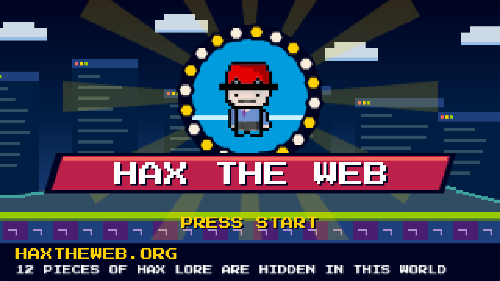

# HAX the Web: attract mode

A 16-bit style title screen and speed run for HAX. Press start, hear an original chiptune jingle, then race a real [`rpg-character`](https://github.com/haxtheweb/webcomponents/tree/main/elements/rpg-character) through the web, jumping into glowing badges that each teach one piece of HAX. At the finish line, a run report shows what you collected, what you missed, and what each piece is.



## Files

| File | Use it for |
|---|---|
| [`index.html`](index.html) | The game. One self-contained page with no build step and no CDN scripts. Publish this folder to any static host (`npx surge .`, Netlify, Vercel, GitHub Pages) or open the file directly. |
| [`media/01-title.png`](media/01-title.png) | Title screen still, 1380×777. Good as a social card (it is the page's `og:image`). |
| [`media/02-run.png`](media/02-run.png) | Mid-run still: the runner has just collected HAXcms, and the bar along the bottom explains it. |
| [`media/03-run-report.png`](media/03-run-report.png) | Full page after a demo run: the results screen and the run report. |
| [`tools/`](tools/) | The template and scripts that build `index.html` and the stills. |

## How it plays

- **Press Start** (or Enter, or tap the screen) plays the jingle, then the run starts. **Jump** with Space, a tap or the Jump button. Yellow arrows on the ground mark where to jump.
- **Play slower** runs the whole game at 60% speed. Gravity is scaled with it, so every jump arc and the level layout stay exactly the same.
- **Player seed** and **Hat** build the runner with `rpg-character`'s own seed math, so any name gives the same character the element would. `btopro`, `zpg` and `edtechjoker` are the element's built-in easter eggs.
- Leave the title screen alone for 12 seconds and a self-playing demo runs. It skips three badges on purpose, so the report always has something in both lists.

The 12 pieces of lore: HAX, HAXcms, site.json, web components, DDD, accessibility, the HAX CLI, the magic script, outline designer, OER, HAXiam and PRAW. Their one-line and full descriptions live in the `LORE` list in [`tools/template.html`](tools/template.html); edit them there and rebuild.

## Brand and components

- **Colors** are DDD tokens (`--ddd-theme-default-*`) everywhere, including inside the game screen, which reads the live DDD variables when it draws. The only colors that aren't DDD are the `rpg-character` pixel-art palettes.
- **Type** is Roboto, Roboto Condensed and the DDD mono font, sized with DDD `data-font-size` attributes. Text inside the game screen uses [Press Start 2P](https://fonts.google.com/specimen/Press+Start+2P) (open-licensed), because Roboto blurs at 8px on a 320-pixel screen.
- **HAX elements:** `d-d-d` loads the design system, `simple-cta` is the Start, Jump and Sound buttons, `simple-fields-field` is the seed, hat and slow-mode controls, and every report entry is an `accent-card`. Keycaps follow the HAX UI `.hax-ui-kbd` style in DDD tokens.

## Alt text

> A pixel-art video game title screen. A small rpg-character in a red cap waves from inside a spinning ring of gold hexagons, above a pink banner that reads "HAX THE WEB" and a blinking "PRESS START". Behind them is a night skyline made of browser windows, and the ground is green and purple blocks. A bar along the bottom reads "HAXTHEWEB.ORG: 12 pieces of HAX lore are hidden in this world."

## Suggested social posts

**LinkedIn**

> Ever wish publishing felt like a speed run? 🎮
>
> With HAX, it kind of does. Drop in blocks, shape your outline, hit publish, and you're grabbing rings on the way to a live site before most platforms finish loading their admin screen. It's so fast you'll feel like Sonic.
>
> HAX = Human + Agent + eXperience. People and AI agents author side by side, remixing each other's work into clean, accessible, portable sites.
>
> So we made a little game to prove it: a 16-bit title screen, an original chiptune, and an rpg-character racing through the web to collect 12 pieces of HAX lore, from HAXcms and DDD to the CLI and OER. Miss one? The run report explains it.
>
> ▶️ Press start: (link)
>
> Just another way HAX is HAX'ing the web.
>
> #HAXTheWeb #OpenSource #WebComponents #OER #EdTech #AI

**X**

> Publishing with HAX is so fast you'll feel like Sonic collecting rings on the way to your live site. 🏁
>
> Human + Agent + eXperience.
>
> Press start and grab all 12 pieces of HAX lore 🎮 (link)
>
> Just another way HAX is HAX'ing the web. #HAXTheWeb

The posts name Sonic as a comparison only. The game itself copies no Sega art, characters, logos or music: the ring, banner and jingle are original.

## Provenance

Made with an AI assistant (Claude) under HAX team direction. The scenery, badges and title art are drawn in code on a canvas, not hand-drawn. The runner is the `rpg-character` element's own SVG art, composed in the element's draw order. The music is an original chiptune synthesized live with Web Audio. It plays only after you press start.

## Rebuild

You need Node.js.

```sh
cd tools
npm install
npm run build    # writes ../index.html from template.html
npx playwright install chromium
npm run stills   # writes ../media/*.png (takes about a minute; the demo plays in real time)
```

`build.mjs` bundles the HAX elements from npm into one inline script, registers the few `simple-fields` icons inline, and embeds every `rpg-character` SVG layer, so the page has no runtime dependencies besides Google Fonts. `stills.mjs` answers the Google Fonts requests from local `@fontsource` packages, so renders match the live page even offline.
