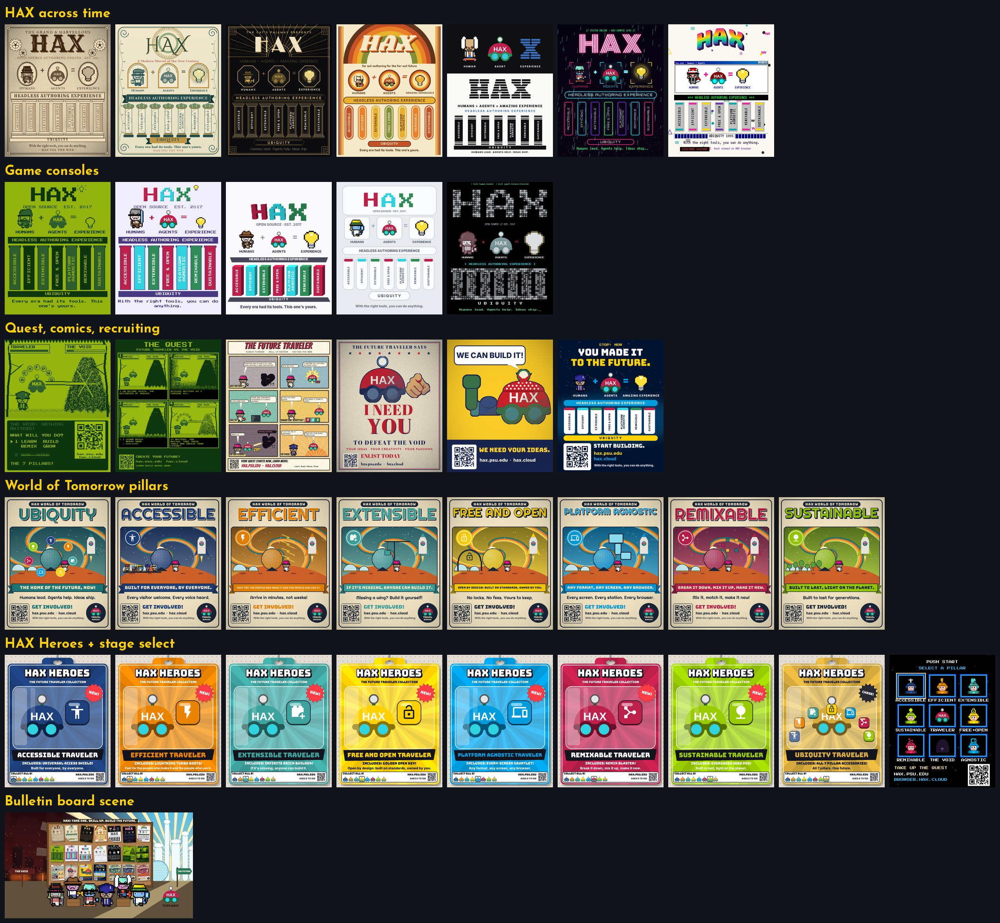

# HAX posters and social media

Posters for the HAX campus and social campaign: HAX across time, console homages, the Quest against THE VOID, recruiting posters, World of Tomorrow pillar posters, HAX Heroes action-figure cards and a bulletin board scene. Every poster has a 1080×1350 social still here; most also have a 5-second MP4, a GIF and an 11×17 campus print.

## Where the files live

- **In this repo (git):** the social stills in [`social/`](social/), the bulletin board still, this README, the [contact sheet](contact-sheet.jpg) and [`posters.json`](posters.json) (catalog with alt text, reuse flags and links).
- **On the release [`media-2026-11`](https://github.com/haxtheweb/art/releases/tag/media-2026-11):** every MP4, GIF and 11×17 print PDF, the pillar stage videos, the story videos, the logo sting, the console intros and `hax_posters_source.tar.gz` (the scripts that render all of it). Release assets are stored by GitHub outside the repo's history, so cloning stays small and nothing is lost. To add a new version later, upload it to a new release rather than committing it.

> The release starts as a **draft**: its download links work once a maintainer publishes it.

## HAX across time

- **1880s steam age**: [still](social/hax_1880s_poster.png) · [MP4](https://github.com/haxtheweb/art/releases/download/media-2026-11/hax_1880s.mp4) · [GIF](https://github.com/haxtheweb/art/releases/download/media-2026-11/hax_1880s.gif) · [11×17 PDF](https://github.com/haxtheweb/art/releases/download/media-2026-11/hax_campus_1880s.pdf)  
  Alt text: Sepia Victorian engraving-style poster: "The Grand & Marvellous HAX, Open Source Authoring Engine" with brass gears, a human, the Future Traveler and a lightbulb forming Humans + Agents = Experience, above seven stone pillars labeled with the HAX pillars on a Ubiquity base.
- **1900s modern marvel**: [still](social/hax_1900s_poster.png) · [MP4](https://github.com/haxtheweb/art/releases/download/media-2026-11/hax_1900s.mp4) · [GIF](https://github.com/haxtheweb/art/releases/download/media-2026-11/hax_1900s.gif) · [11×17 PDF](https://github.com/haxtheweb/art/releases/download/media-2026-11/hax_campus_1900s.pdf)  
  Alt text: Cream Art Nouveau poster: "HAX, a Modern Marvel of the New Century" with a human, the Future Traveler and a lightbulb, a Headless Authoring Experience ribbon and seven pillars on a Ubiquity base.
- **1920s roaring twenties**: [still](social/hax_1920s_poster.png) · [MP4](https://github.com/haxtheweb/art/releases/download/media-2026-11/hax_1920s.mp4) · [GIF](https://github.com/haxtheweb/art/releases/download/media-2026-11/hax_1920s.gif) · [11×17 PDF](https://github.com/haxtheweb/art/releases/download/media-2026-11/hax_campus_1920s.pdf)  
  Alt text: Black and gold Art Deco poster: "The Cat's Pajamas presents HAX, Humans + Agents = Amazing Experience" with seven gold-lined pillars on Ubiquity and the line "Humans lead. Agents help. Ideas ship."
- **1970s rainbow**: [still](social/hax_1970s_poster.png) · [MP4](https://github.com/haxtheweb/art/releases/download/media-2026-11/hax_1970s.mp4) · [GIF](https://github.com/haxtheweb/art/releases/download/media-2026-11/hax_1970s.gif) · [11×17 PDF](https://github.com/haxtheweb/art/releases/download/media-2026-11/hax_campus_1970s.pdf)  
  Alt text: Warm 1970s poster with a rainbow arch over chunky HAX lettering, three circular badges for humans, agents and experience, and seven striped pillars on Ubiquity. Tagline: "Every era had its tools. This one's yours."
- **1980s corporate (Paul Rand homage)** ⚠️ homage, review before promoting: [still](social/hax_1980s_poster.png) · [MP4](https://github.com/haxtheweb/art/releases/download/media-2026-11/hax_1980s.mp4) · [GIF](https://github.com/haxtheweb/art/releases/download/media-2026-11/hax_1980s.gif) · [11×17 PDF](https://github.com/haxtheweb/art/releases/download/media-2026-11/hax_campus_1980s.pdf)  
  Alt text: Striped black-and-white 1980s corporate poster riffing on Paul Rand: pixel human, Future Traveler and lightbulb above striped HAX letters, with seven striped pillars on Ubiquity.
- **1980s cyberpunk**: [still](social/hax_1980s_cyberpunk_poster.png) · [MP4](https://github.com/haxtheweb/art/releases/download/media-2026-11/hax_1980s_cyberpunk.mp4) · [GIF](https://github.com/haxtheweb/art/releases/download/media-2026-11/hax_1980s_cyberpunk.gif) · [11×17 PDF](https://github.com/haxtheweb/art/releases/download/media-2026-11/hax_campus_1980s_cyberpunk.pdf)  
  Alt text: Neon pink and cyan cyberpunk poster on a dark grid: glowing HAX, Humans + Agents = Experience in neon frames and seven neon pillars on Ubiquity.
- **1990s early web**: [still](social/hax_1990s_poster.png) · [MP4](https://github.com/haxtheweb/art/releases/download/media-2026-11/hax_1990s.mp4) · [GIF](https://github.com/haxtheweb/art/releases/download/media-2026-11/hax_1990s.gif) · [11×17 PDF](https://github.com/haxtheweb/art/releases/download/media-2026-11/hax_campus_1990s.pdf)  
  Alt text: Early-web style poster with rainbow WordArt-like HAX, a Windows-style dialog showing Humans + Agents = Experience, a Headless Authoring Experience banner, seven pillars and a "Ubiquity 100%" progress bar.

## Game consoles

- **Game Boy** ⚠️ homage, review before promoting: [still](social/hax_gameboy_poster.png) · [MP4](https://github.com/haxtheweb/art/releases/download/media-2026-11/hax_gameboy.mp4) · [GIF](https://github.com/haxtheweb/art/releases/download/media-2026-11/hax_gameboy.gif) · [11×17 PDF](https://github.com/haxtheweb/art/releases/download/media-2026-11/hax_campus_gameboy.pdf)  
  Alt text: Four-shade green handheld-console poster: HAX in pixel type, "Open Source, Est. 2017", humans + agents = experience sprites and seven pixel pillars on Ubiquity.
- **Game Boy Advance** ⚠️ homage, review before promoting: [still](social/hax_gba_poster.png) · [MP4](https://github.com/haxtheweb/art/releases/download/media-2026-11/hax_gba.mp4) · [GIF](https://github.com/haxtheweb/art/releases/download/media-2026-11/hax_gba.gif) · [11×17 PDF](https://github.com/haxtheweb/art/releases/download/media-2026-11/hax_campus_gba.pdf)  
  Alt text: Bright handheld-console poster in pink, blue and green pixel type with humans + agents = experience sprites and seven colored pillars on Ubiquity.
- **PlayStation** ⚠️ homage, review before promoting: [still](social/hax_ps_poster.png) · [MP4](https://github.com/haxtheweb/art/releases/download/media-2026-11/hax_ps.mp4) · [GIF](https://github.com/haxtheweb/art/releases/download/media-2026-11/hax_ps.gif) · [11×17 PDF](https://github.com/haxtheweb/art/releases/download/media-2026-11/hax_campus_ps.pdf)  
  Alt text: Pale grey 32-bit console poster: chunky 3D HAX letters in red, teal and green, a pixel explorer + the Future Traveler = a lightbulb, and seven 3D colored pillars on Ubiquity. Tagline: "Every era had its tools. This one's yours."
- **Wii** ⚠️ homage, review before promoting: [still](social/hax_wii_poster.png) · [MP4](https://github.com/haxtheweb/art/releases/download/media-2026-11/hax_wii.mp4) · [GIF](https://github.com/haxtheweb/art/releases/download/media-2026-11/hax_wii.gif) · [11×17 PDF](https://github.com/haxtheweb/art/releases/download/media-2026-11/hax_campus_wii.pdf)  
  Alt text: White console-menu style poster with rounded panels: HAX in red, cyan and green pixel letters, a human, the Future Traveler and a lightbulb in rounded tiles, and seven pill-shaped pillars on Ubiquity.
- **Hacker** ⚠️ homage, review before promoting: [still](social/hax_hacker_poster.png) · [MP4](https://github.com/haxtheweb/art/releases/download/media-2026-11/hax_hacker.mp4) · [GIF](https://github.com/haxtheweb/art/releases/download/media-2026-11/hax_hacker.gif) · [11×17 PDF](https://github.com/haxtheweb/art/releases/download/media-2026-11/hax_campus_hacker.pdf)  
  Alt text: Black terminal-style poster with HAX built from ASCII blocks, a hooded human, the Future Traveler and a lightbulb, and glitching ASCII pillars on Ubiquity.

## Quest, comics, recruiting

- **HAX Quest** ⚠️ homage, review before promoting: [still](social/hax_quest_poster.png) · [MP4](https://github.com/haxtheweb/art/releases/download/media-2026-11/hax_quest.mp4) · [GIF](https://github.com/haxtheweb/art/releases/download/media-2026-11/hax_quest.gif) · [11×17 PDF](https://github.com/haxtheweb/art/releases/download/media-2026-11/hax_campus_quest.pdf)  
  Alt text: Green Game Boy-style RPG battle: the Future Traveler casts the seven pillars as spells at THE VOID, a dark cloud saying "Nothing matters." Menu: Learn, Build, Remix, Grow, with Run and Hide crossed out. QR code to hax.psu.edu.
- **HAX Quest comic** ⚠️ homage, review before promoting: [still](social/hax_quest_comic_poster.png) · [11×17 PDF](https://github.com/haxtheweb/art/releases/download/media-2026-11/hax_campus_quest_comic.pdf)  
  Alt text: "The Quest: Future Traveler vs the Void" as four Game Boy-style battle panels, ending with "Create your future!" and a QR code.
- **Sunday Funnies**: [still](social/hax_sunday_poster.png) · [MP4](https://github.com/haxtheweb/art/releases/download/media-2026-11/hax_sunday.mp4) · [GIF](https://github.com/haxtheweb/art/releases/download/media-2026-11/hax_sunday.gif) · [11×17 PDF](https://github.com/haxtheweb/art/releases/download/media-2026-11/hax_campus_sunday.pdf)  
  Alt text: 1960s halftone Sunday comic strip, "The Future Traveler: Sunday Funnies, Skill Up Edition," in six panels: a student who thinks nothing matters meets the Future Traveler, learns web components, builds and remixes, and together they zap the Void. Ends with "Your quest starts now," a QR code, hax.psu.edu and hax.cloud.
- **I Need You** ⚠️ homage, review before promoting: [still](social/hax_needyou_poster.png) · [MP4](https://github.com/haxtheweb/art/releases/download/media-2026-11/hax_needyou.mp4) · [GIF](https://github.com/haxtheweb/art/releases/download/media-2026-11/hax_needyou.gif) · [11×17 PDF](https://github.com/haxtheweb/art/releases/download/media-2026-11/hax_campus_needyou.pdf)  
  Alt text: Vintage recruiting poster: the Future Traveler points at the viewer above "I NEED YOU to defeat the Void. Your ideas. Your creativity. Your passions. Enlist today."
- **We Can Build It!** ⚠️ homage, review before promoting: [still](social/hax_wecan_poster.png) · [MP4](https://github.com/haxtheweb/art/releases/download/media-2026-11/hax_wecan.mp4) · [GIF](https://github.com/haxtheweb/art/releases/download/media-2026-11/hax_wecan.gif) · [11×17 PDF](https://github.com/haxtheweb/art/releases/download/media-2026-11/hax_campus_wecan.pdf)  
  Alt text: Yellow wartime-style poster: the Future Traveler flexes a green arm under a speech bubble reading "We can build it!" with "We need your ideas," a QR code and hax.psu.edu.
- **You made it to the future**: [still](social/hax_now_poster.png) · [MP4](https://github.com/haxtheweb/art/releases/download/media-2026-11/hax_now.mp4) · [GIF](https://github.com/haxtheweb/art/releases/download/media-2026-11/hax_now.gif) · [11×17 PDF](https://github.com/haxtheweb/art/releases/download/media-2026-11/hax_campus_now.pdf)  
  Alt text: Starry 8-bit poster: "STOP: NOW. You made it to the future." Humans + Agents = Amazing Experience, seven pillars on Ubiquity, "Start building." and a QR code.

## World of Tomorrow pillars

- **World of Tomorrow: UBIQUITY** ⚠️ homage, review before promoting: [still](social/hax_tomorrow_all_poster.png) · [MP4](https://github.com/haxtheweb/art/releases/download/media-2026-11/hax_tomorrow_all.mp4) · [GIF](https://github.com/haxtheweb/art/releases/download/media-2026-11/hax_tomorrow_all.gif) · [11×17 PDF](https://github.com/haxtheweb/art/releases/download/media-2026-11/hax_campus_tomorrow_all.pdf)  
  Alt text: 1960s travel-poster style: a pixel Future Traveler beside a geodesic sphere, rocket and rainbow on a red planet, tinted in all seven pillar colors. Title "UBIQUITY", tagline "The home of the future, now!", with a QR code and hax.psu.edu.
- **World of Tomorrow: ACCESSIBLE** ⚠️ homage, review before promoting: [still](social/hax_tomorrow_accessible_poster.png) · [MP4](https://github.com/haxtheweb/art/releases/download/media-2026-11/hax_tomorrow_accessible.mp4) · [GIF](https://github.com/haxtheweb/art/releases/download/media-2026-11/hax_tomorrow_accessible.gif) · [11×17 PDF](https://github.com/haxtheweb/art/releases/download/media-2026-11/hax_campus_tomorrow_accessible.pdf)  
  Alt text: 1960s travel-poster style: a pixel Future Traveler beside a geodesic sphere, rocket and rainbow on a red planet, tinted Beaver Blue. Title "ACCESSIBLE", tagline "Built for everyone, by everyone.", with a QR code and hax.psu.edu.
- **World of Tomorrow: EFFICIENT** ⚠️ homage, review before promoting: [still](social/hax_tomorrow_efficient_poster.png) · [MP4](https://github.com/haxtheweb/art/releases/download/media-2026-11/hax_tomorrow_efficient.mp4) · [GIF](https://github.com/haxtheweb/art/releases/download/media-2026-11/hax_tomorrow_efficient.gif) · [11×17 PDF](https://github.com/haxtheweb/art/releases/download/media-2026-11/hax_campus_tomorrow_efficient.pdf)  
  Alt text: 1960s travel-poster style: a pixel Future Traveler beside a geodesic sphere, rocket and rainbow on a red planet, tinted Invent Orange. Title "EFFICIENT", tagline "Fast for the people who make it and the people who use it.", with a QR code and hax.psu.edu.
- **World of Tomorrow: EXTENSIBLE** ⚠️ homage, review before promoting: [still](social/hax_tomorrow_extensible_poster.png) · [MP4](https://github.com/haxtheweb/art/releases/download/media-2026-11/hax_tomorrow_extensible.mp4) · [GIF](https://github.com/haxtheweb/art/releases/download/media-2026-11/hax_tomorrow_extensible.gif) · [11×17 PDF](https://github.com/haxtheweb/art/releases/download/media-2026-11/hax_campus_tomorrow_extensible.pdf)  
  Alt text: 1960s travel-poster style: a pixel Future Traveler beside a geodesic sphere, rocket and rainbow on a red planet, tinted Creek Teal. Title "EXTENSIBLE", tagline "If it's missing, anyone can build it.", with a QR code and hax.psu.edu.
- **World of Tomorrow: FREE AND OPEN** ⚠️ homage, review before promoting: [still](social/hax_tomorrow_open_poster.png) · [MP4](https://github.com/haxtheweb/art/releases/download/media-2026-11/hax_tomorrow_open.mp4) · [GIF](https://github.com/haxtheweb/art/releases/download/media-2026-11/hax_tomorrow_open.gif) · [11×17 PDF](https://github.com/haxtheweb/art/releases/download/media-2026-11/hax_campus_tomorrow_open.pdf)  
  Alt text: 1960s travel-poster style: a pixel Future Traveler beside a geodesic sphere, rocket and rainbow on a red planet, tinted Keystone Yellow. Title "FREE AND OPEN", tagline "Open by design: built on standards, owned by you.", with a QR code and hax.psu.edu.
- **World of Tomorrow: PLATFORM AGNOSTIC** ⚠️ homage, review before promoting: [still](social/hax_tomorrow_agnostic_poster.png) · [MP4](https://github.com/haxtheweb/art/releases/download/media-2026-11/hax_tomorrow_agnostic.mp4) · [GIF](https://github.com/haxtheweb/art/releases/download/media-2026-11/hax_tomorrow_agnostic.gif) · [11×17 PDF](https://github.com/haxtheweb/art/releases/download/media-2026-11/hax_campus_tomorrow_agnostic.pdf)  
  Alt text: 1960s travel-poster style: a pixel Future Traveler beside a geodesic sphere, rocket and rainbow on a red planet, tinted Sky Blue. Title "PLATFORM AGNOSTIC", tagline "Any format, any screen, any browser.", with a QR code and hax.psu.edu.
- **World of Tomorrow: REMIXABLE** ⚠️ homage, review before promoting: [still](social/hax_tomorrow_remixable_poster.png) · [MP4](https://github.com/haxtheweb/art/releases/download/media-2026-11/hax_tomorrow_remixable.mp4) · [GIF](https://github.com/haxtheweb/art/releases/download/media-2026-11/hax_tomorrow_remixable.gif) · [11×17 PDF](https://github.com/haxtheweb/art/releases/download/media-2026-11/hax_campus_tomorrow_remixable.pdf)  
  Alt text: 1960s travel-poster style: a pixel Future Traveler beside a geodesic sphere, rocket and rainbow on a red planet, tinted Original 87 Pink. Title "REMIXABLE", tagline "Break it down, mix it up, make it new.", with a QR code and hax.psu.edu.
- **World of Tomorrow: SUSTAINABLE** ⚠️ homage, review before promoting: [still](social/hax_tomorrow_sustainable_poster.png) · [MP4](https://github.com/haxtheweb/art/releases/download/media-2026-11/hax_tomorrow_sustainable.mp4) · [GIF](https://github.com/haxtheweb/art/releases/download/media-2026-11/hax_tomorrow_sustainable.gif) · [11×17 PDF](https://github.com/haxtheweb/art/releases/download/media-2026-11/hax_campus_tomorrow_sustainable.pdf)  
  Alt text: 1960s travel-poster style: a pixel Future Traveler beside a geodesic sphere, rocket and rainbow on a red planet, tinted Future Lime. Title "SUSTAINABLE", tagline "Built to last, light on the planet.", with a QR code and hax.psu.edu.

## HAX Heroes

- **HAX Heroes: Accessible Traveler**: [still](social/hax_heroes_accessible_poster.png) · [MP4](https://github.com/haxtheweb/art/releases/download/media-2026-11/hax_heroes_accessible.mp4) · [GIF](https://github.com/haxtheweb/art/releases/download/media-2026-11/hax_heroes_accessible.gif)  
  Alt text: Toy blister card, "HAX Heroes, the Future Traveler collection": a blue Future Traveler figure with its universal access shield in the bubble, labeled "Accessible Traveler".
- **HAX Heroes: Efficient Traveler**: [still](social/hax_heroes_efficient_poster.png) · [MP4](https://github.com/haxtheweb/art/releases/download/media-2026-11/hax_heroes_efficient.mp4) · [GIF](https://github.com/haxtheweb/art/releases/download/media-2026-11/hax_heroes_efficient.gif)  
  Alt text: Toy blister card, "HAX Heroes, the Future Traveler collection": a orange Future Traveler figure with its lightning turbo boots in the bubble, labeled "Efficient Traveler".
- **HAX Heroes: Extensible Traveler**: [still](social/hax_heroes_extensible_poster.png) · [MP4](https://github.com/haxtheweb/art/releases/download/media-2026-11/hax_heroes_extensible.mp4) · [GIF](https://github.com/haxtheweb/art/releases/download/media-2026-11/hax_heroes_extensible.gif)  
  Alt text: Toy blister card, "HAX Heroes, the Future Traveler collection": a teal Future Traveler figure with its infinite brick builder in the bubble, labeled "Extensible Traveler".
- **HAX Heroes: Free and Open Traveler**: [still](social/hax_heroes_open_poster.png) · [MP4](https://github.com/haxtheweb/art/releases/download/media-2026-11/hax_heroes_open.mp4) · [GIF](https://github.com/haxtheweb/art/releases/download/media-2026-11/hax_heroes_open.gif)  
  Alt text: Toy blister card, "HAX Heroes, the Future Traveler collection": a yellow Future Traveler figure with its golden open key in the bubble, labeled "Free and Open Traveler".
- **HAX Heroes: Platform Agnostic Traveler**: [still](social/hax_heroes_agnostic_poster.png) · [MP4](https://github.com/haxtheweb/art/releases/download/media-2026-11/hax_heroes_agnostic.mp4) · [GIF](https://github.com/haxtheweb/art/releases/download/media-2026-11/hax_heroes_agnostic.gif)  
  Alt text: Toy blister card, "HAX Heroes, the Future Traveler collection": a sky blue Future Traveler figure with its every-screen gauntlet in the bubble, labeled "Platform Agnostic Traveler".
- **HAX Heroes: Remixable Traveler**: [still](social/hax_heroes_remixable_poster.png) · [MP4](https://github.com/haxtheweb/art/releases/download/media-2026-11/hax_heroes_remixable.mp4) · [GIF](https://github.com/haxtheweb/art/releases/download/media-2026-11/hax_heroes_remixable.gif)  
  Alt text: Toy blister card, "HAX Heroes, the Future Traveler collection": a pink Future Traveler figure with its remix blaster in the bubble, labeled "Remixable Traveler".
- **HAX Heroes: Sustainable Traveler**: [still](social/hax_heroes_sustainable_poster.png) · [MP4](https://github.com/haxtheweb/art/releases/download/media-2026-11/hax_heroes_sustainable.mp4) · [GIF](https://github.com/haxtheweb/art/releases/download/media-2026-11/hax_heroes_sustainable.gif)  
  Alt text: Toy blister card, "HAX Heroes, the Future Traveler collection": a lime Future Traveler figure with its evergreen seed pod in the bubble, labeled "Sustainable Traveler".
- **HAX Heroes: Ubiquity Traveler (chase figure)**: [still](social/hax_heroes_ubiquity_poster.png) · [MP4](https://github.com/haxtheweb/art/releases/download/media-2026-11/hax_heroes_ubiquity.mp4) · [GIF](https://github.com/haxtheweb/art/releases/download/media-2026-11/hax_heroes_ubiquity.gif)  
  Alt text: Toy blister card, "HAX Heroes, the Future Traveler collection": a gold Future Traveler figure with its all seven pillar accessories in the bubble, labeled "Ubiquity Traveler (chase figure)".
- **Select a Pillar** ⚠️ homage, review before promoting: [still](social/hax_stage_select_poster.png) · [MP4](https://github.com/haxtheweb/art/releases/download/media-2026-11/hax_stage_select.mp4) · [GIF](https://github.com/haxtheweb/art/releases/download/media-2026-11/hax_stage_select.gif)  
  Alt text: NES-style "Push start, select a pillar" grid: eight-bit heads for the seven pillars, the Future Traveler in the center and THE VOID, with a QR code to hax.psu.edu.

## Scenes

- **Bulletin board**: [still](hax_bulletin_board.png) · [MP4](https://github.com/haxtheweb/art/releases/download/media-2026-11/hax_bulletin_board.mp4) · [GIF](https://github.com/haxtheweb/art/releases/download/media-2026-11/hax_bulletin_board.gif)  
  Alt text: A campus bulletin board covered in the HAX posters, some peeling, under the banner "HAX: Take one. Skill up. Build the future." Pixel students reach up to read them; the Void looms on the left and a bright future city glows on the right, where the Future Traveler waits.

## Videos without a poster

All on the release; see `release_assets` in [`posters.json`](posters.json) for every file.

- **Pillar stages** (`hax_stage_<pillar>_full.mp4`, 42 s each, 1080×1350): an 8-bit stage select, a power card, a live demo recorded on the real haxtheweb.org, and a stage-clear card with a QR code. Each comes as four separate segment files (`_1_select`, `_2_card`, `_3_demo`, `_4_clear`) so the demo can be swapped. Pillars: accessible, efficient, extensible, open, agnostic, remixable, sustainable.
- **Stories** (1920×1080): `hax_story_generic` (three fictional students) and `hax_story_real` (Jimmy Kane, Winston White and Zach Dodson). Get each person's OK before posting the real one.
- **Logo sting:** `hax_logo_sting.mp4` (with jingle) and GIFs at full size, 480, 400 and 360 px.
- **Console intros:** `hax_intro_<gameboy|gba|playstation|n64|wii|hacker>` MP4 and GIF. Homages: review before promoting.

## Links on the art

QR codes go to https://hax.psu.edu. Printed links: hax.psu.edu, browser.hax.cloud and hax.cloud.

## Provenance

Rendered procedurally by Claude (an AI assistant) in Python (Pillow, NumPy, ffmpeg) under HAX team direction, not hand-drawn. Characters come from the [`rpg-character`](https://github.com/haxtheweb/webcomponents/tree/main/elements/rpg-character) element and the `hax:world-traveler` icon (the Future Traveler). Pillar icons are Material Symbols (Apache-2.0); fonts are open-licensed (SIL OFL), including Press Start 2P. Music and sound effects are synthesized in code. The pillar stage demos are real recordings of https://haxtheweb.org, and the numbers on screen were measured from the live site in November 2026.

Pieces flagged ⚠️ riff on other works or brands (console start-ups, recruiting posters, 1960s travel posters, an 8-bit boss-select screen, Paul Rand's striped logo style). They copy no specific artwork, but per [LICENSING.md](../../LICENSING.md) treat them as community art and review before official promotion.
