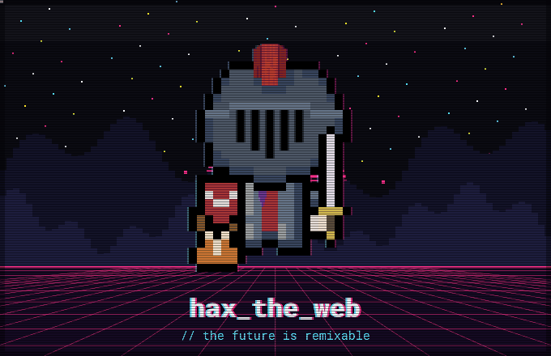

# RPG Glitch

The HAX [`rpg-character`](https://github.com/haxtheweb/webcomponents/tree/main/elements/rpg-character) on an 80s CRT, glitching between versions of itself over a synthwave landscape. Click the screen and it glitches hard into a brand new character: costumes, pets, moods, poses, masks, makeup and things to hold, all from the element's own wardrobe. Every character has its own link, and its own `<rpg-character code="…">` embed for any HAX page.



## Files

| File | Use it for |
|---|---|
| [`index.html`](index.html) | The live page, no build step. Click or press Remix for a new character; pick a costume, pet, mood or pose, set it on fire, pause the glitch, copy the link or the HAX embed, or share. It loads the element's code, overlay and season modules as ES modules, so serve it over http(s) (any static host, or `npx serve`); opening the file directly won't work. |
| [`media/rpg-glitch-still.png`](media/rpg-glitch-still.png) | 1360×880 still (`btopro` as a knight with a dog). Used as the page's social preview image. |
| [`media/rpg-glitch.gif`](media/rpg-glitch.gif) | 680px loop: knight with a dog, pirate with a parrot, wizard with an owl on fire, scientist with a slime, cheering astronaut, witch with a bat. For READMEs and chat. |
| [`rpg-character/`](rpg-character/) | The element's SVG layers plus its `rpg-character-code.js`, `rpg-character-overlays.js` and `rpg-character-seasons.js`, copied from `webcomponents` main so the page works on any static host. Refresh with `tools/sync-art.sh`; don't hand-edit. |
| [`tools/`](tools/) | `render.mjs` re-renders the still and GIF from `index.html`; `sync-art.sh` refreshes `rpg-character/` from `webcomponents` main. |

## Shareable links

The URL always holds the current character:

| Parameter | Meaning |
|---|---|
| `code` | An `rpg-character` character code, the same one the element's `code` attribute and `rpg-character-builder` use. It recalls every choice: traits, costume, hat, mask, makeup, held items, pet, mood, pose, fire. |
| `seed` | Either [rpg-me](https://github.com/haxtheweb/rpg-me)'s 8-digit seed (base, face, face item, hair, pants, shirt, skin, hat color) or any word, which goes through `rpg-character`'s own seed logic (`btopro`, `zpg` and `edtechjoker` are its easter eggs). |
| `hat`, `fire`, `accessories` | Extras for `seed` links, as in rpg-me. `hat=random` picks an everyday hat. |

Examples: `?seed=btopro`, `?seed=zpg&hat=pirate`, `?seed=12345678&hat=ninja&fire=true`, or any `?code=1-…` from the page.

**Copy HAX embed** copies `<rpg-character code="…"></rpg-character>`, which drops the exact same character into any HAX page.

**Edit in rpg-me** opens the base look (the 8 digits, plus the hat if rpg-me knows it, plus fire). rpg-me doesn't read character codes yet, so costumes, pets, moods and poses don't carry over.

When the page runs inside someone else's frame (a preview or an embed), Copy link and the share buttons hide, since the framed URL isn't shareable; Copy HAX embed still works.

## What's left out

The element's 18 pop-culture archetype presets are nods to other studios' characters. RPG Glitch leaves 13 of them out, along with their signature pieces, and never rolls them, copies their art or shows them from a code. It keeps the generic and folklore ones: masked wrestler, werewolf, headless horseman, lion mascot and marching band. The exact list is `EXCLUDED` in `index.html` and `EXCLUDE` in `tools/sync-art.sh`. Keep the two in step.

## How it moves

A burst of about 0.3 s: the character is sliced into rows that swap between the old and new versions (plus a flash of the `error` hat), with RGB channel splits, pixelation, screen tears, block corruption and static. Then it holds still for about 4 s so you can see the character. While idle, it glitches through other outfits for the same person every few seconds and lands back on its own look. Scan lines sit over the whole scene.

Remix rolls a costume about 60% of the time and a freestyle mix of hat, held item, mask, makeup, off-hand item and feet the rest. Pets, moods, poses and fire are layered on top. In season (Halloween from mid-October, Christmas, Easter, the Fourth of July), the element's seasonal costumes come up more often.

**Pause glitch** stops all motion. People who set "reduce motion" in their system get the paused version by default; clicking still swaps characters, just without the animation.

## Alt text

> Pixel-art scene on an old CRT screen: a small RPG character stands in front of dark purple pixel mountains under a starry sky, above a glowing magenta perspective grid. Every few seconds the character tears apart into cyan and magenta slices and static, then reassembles in a different costume or as a different character, sometimes with a pet beside it. Below it, glitchy text reads "hax_the_web" and "// the future is remixable".

## Suggested social caption

> Glitch your way to a new RPG character. Every click is a remix, and every remix has a link. The future is remixable.
>
> #HAXTheWeb #OpenSource #WebComponents #PixelArt

## Provenance

Made with an AI assistant (Claude) under HAX team direction. The scene, glitch effects and CRT treatment are procedural canvas code, not hand-drawn. The characters are the `rpg-character` element's own art, composed in the element's draw order with its seed, preset, character-code and overlay rules (the code and overlay modules are the element's own files). The glitch style was inspired by the general hacker and glitch-art aesthetic; it copies no specific third-party artwork.

## Hosting

`index.html`, `rpg-character/` and `media/` make up a standalone static site. Publish this folder to any static host (GitHub Pages, Netlify, Vercel, `npx surge .`). Links only work on a host, since they point back at the page itself.

## Rebuild the media

You need Node.js and `ffmpeg`.

```sh
cd tools
npm install
npx playwright install chromium
npm run all        # still, then gif
npm run sync-art   # optional: refresh rpg-character/ from webcomponents main
```
