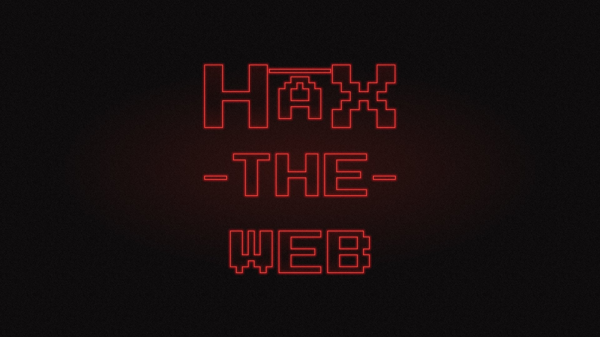

# HAX The Web opening titles

A 30-second neon title sequence for HAX, done as a fan homage to the synth-scored opening of a certain 1980s-set TV series. Close-ups of red neon letters drift by while credits tell the story from a napkin in 2015 to hundreds of courses. Then the letters lock into a three-line **HAX / THE / WEB** mark and the end card reads "Open content changes the world."

## Files

| File | Use it for |
|---|---|
| [`index.html`](index.html) | The piece itself. One self-contained page with no build step: play, pause, scrub, restart, mute, and a Script panel with every credit as text. Keyboard: space plays and pauses, the arrow keys jump 3 s. |
| [`media/stills/`](media/stills/) | 1920×1080 JPEGs: `napkin.jpg` (a credit over a letter close-up), `title-lock.jpg` (the finished mark, also the social preview image) and `end-card.jpg`. |

## Timeline

| Time | What happens |
|---|---|
| 0:00 to 0:16 | Six credits over slow close-ups of single letters: Headless Authoring eXperience; from a napkin in 2015; 675 web components and 53 editor blocks; 247 sites and 67,515 students; 567 students who learned the web by building it; content you own. |
| 0:16 to 0:22 | The letters glide in from off screen and assemble. The light bars grow in last. |
| 0:22 | The title locks, on a low boom and a chord hit. |
| 0:23 to 0:30 | The mark lifts to the top and the end card fades in, with links to haxtheweb.org, GitHub and Discord. One tube in WEB keeps flickering. |

## Sources

- **Figures:** the HAX history timeline and the 2015 to 2025 totals slide in this folder's parent, [`presentation-materials/`](../).
- **Type:** the glowing letters and the end-card headline use Press Start 2P, the pixel face from the HAX endcard art (`haxtheweb/HAX endcard v2.psd`) and the HAX The Web sticker. Credits use Questrial, a free stand-in for the geometric sans of the original style. Both load from Google Fonts.
- **Score:** original, synthesized live in the browser with the Web Audio API: a 16th-note arpeggio through a filter that slowly opens, a pulsing bass, a slow pad, a riser and a hit timed to the title lock. It evokes the genre and does not reproduce any existing theme.

## Provenance and rights

Made with an AI assistant (Claude) under HAX team direction. It replaces the broken CSS-only attempt in [btopro/stranger-things](https://github.com/btopro/stranger-things), which was forked from wbobeirne's CSS demo. No commercial font file or recorded music is bundled.

It is a parody homage. HAX claims no intellectual property in Stranger Things, which belongs to Netflix. As with the parody World Traveler variants (see [`LICENSING.md`](../../LICENSING.md)), review it before any official promotion.

## Posting it

`index.html` and `media/` make up a standalone static site. To share a short-lived link, publish this folder to any static host, for example `npx surge .`, Netlify, Vercel or GitHub Pages.

## Editing

Everything is in `index.html`:
- the `CREDITS` array holds the credit text
- the `T` object holds the timing in seconds
- the `SHOTS` array sets the camera close-ups
- `CHORDS` and `EVENTS` hold the score

Every frame is a pure function of time, so you can scrub to any moment to check an edit.
